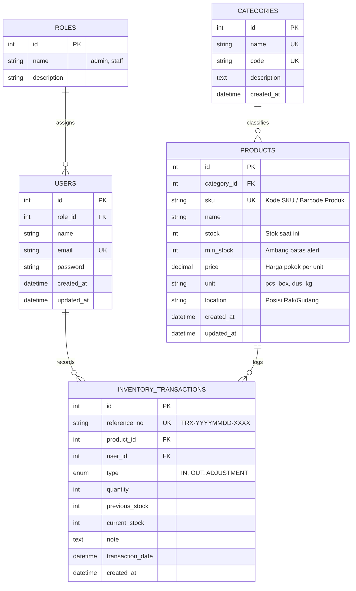

# Product Requirements Document (PRD)
## Sistem Manajemen Inventaris Gudang (Warehouse Inventory Management System)
**Mata Kuliah:** UAS Web Application Development — Universitas Cakrawala  
**Pilihan Studi Kasus:** Sistem Manajemen Operasional (Inventaris Gudang)  
**Pendekatan Arsitektur:** Full-Stack Modern Web Application (Backend Express.js MVC API + Frontend Vue 3)  
**Runtime & Stack:** Node.js, Express.js, MySQL (Sequelize ORM), Vue 3 (Vite, Pinia, Vue Router)

---

## 1. Executive Summary & Ringkasan Objektif

Aplikasi ini adalah **Sistem Informasi Manajemen Inventaris Gudang** berbasis web modern yang dirancang untuk mengelola stok barang, alur pergerakan barang (*stock in/stock out*), kategorisasi produk, audit jejak transaksi logistik, serta kontrol akses multi-peran (*Admin Gudang* dan *Petugas/Operator Gudang*).

Sistem diimplementasikan menggunakan:
- **Backend:** Node.js + Express.js dengan arsitektur **MVC** (Model, View/Serializer, Controller) melayani RESTful API, validasi input ketat, dan proteksi keamanan.
- **Frontend:** **Vue 3** (Single Page Application dengan Vite) yang modern, reaktif, cepat, dan intuitif.
- **Database:** **MySQL** relasional dengan **Sequelize ORM** (5 tabel berelasi).

Dokumen ini memastikan seluruh capaian pembelajaran (CPMK 1 hingga CPMK 5) terpenuhi 100%.

---

## 2. Pemetaan Rubrik Penilaian (CPMK) ke Stack Vue 3 + Node.js

| No | Parameter & CPMK | Bobot | Ketentuan Dokumen UAS | Padanan Implementasi Proyek (Vue 3 + Node.js) |
|---|---|:---:|---|---|
| **1** | **Perancangan & Arsitektur Full-Stack (CPMK 1)** | **15%** | ERD 4+ tabel relasi, alur arsitektur, routing MVC | **ERD 5 Tabel Relasional** (Users, Roles, Categories, Products, InventoryTransactions). Diagram arsitektur client-server MVC decoupled dengan routing Express & Vue Router. |
| **2** | **Implementasi Backend & Database (CPMK 2 & 3)** | **35%** | CRUD lengkap, ORM / Query Builder, MySQL, validasi server-side ketat | **Express.js + Sequelize ORM** dengan MySQL. Operasi CRUD lengkap (Produk, Kategori, Mutasi Stok). Validasi data server-side via **express-validator**. |
| **3** | **Keamanan Web & Manajemen Sesi (CPMK 4)** | **15%** | Auth (Register, Login, Logout), Session/JWT, CSRF, XSS sanitization, Anti SQL Injection, RBAC | **Autentikasi aman JWT via HttpOnly Cookie** (atau session token), enkripsi password **bcryptjs**, sanitasi XSS (**helmet** & validator), proteksi **SQL Injection via Sequelize Parameterized Queries**, serta middleware **Role-Based Access Control (Admin vs Staff)**. |
| **4** | **Deployment Live App (CPMK 5)** | **10%** | Deploy hosting publik (Render/Railway/Vercel/VPS) + live URL | Frontend di-deploy ke **Vercel / Netlify / Render**, Backend di **Render / Railway**, dan Database di **Aiven MySQL / Railway / TiDB Cloud**. Dokumentasi step-by-step lengkap. |
| **5** | **Esai & Video Demo (CPMK 1–5)** | **25%** | Video penjelasan alur data, pattern MVC, skema DB, logika backend, error handling, security, deployment | Disediakan panduan naskah presentasi, demonstrasi fitur, serta jawaban lengkap untuk pertanyaan esai teknis. |

---

## 3. Tech Stack Architecture

### 3.1 Backend (Server-Side MVC API)
* **Runtime:** Node.js (v18 / v20 / v22 LTS)
* **Framework:** `Express.js` 
* **Arsitektur:** Controller memproses request bisnis, Model merepresentasikan skema basis data, dan Response formatter bertindak sebagai View/Presenter JSON.
* **ORM:** `Sequelize ORM` + `mysql2`
* **Keamanan & Validasi:**
  * `bcryptjs`: Hashing password aman
  * `jsonwebtoken` & `cookie-parser`: Manajemen autentikasi berbasis token tersimpan aman di cookie `HttpOnly` / Authorization header
  * `express-validator`: Validasi ketat di sisi server (tipe data, format SKU, rentang stok, validasi referensi ID)
  * `helmet` & `cors`: Proteksi security headers dan pembatasan origin API
  * `csrf-csrf` / Double Submit Cookie untuk proteksi CSRF

### 3.2 Frontend (Vue 3 Client)
* **Framework:** `Vue 3` (Composition API `<script setup>`)
* **Build Tool:** `Vite` (Sangat cepat dan ringan)
* **State Management:** `Pinia` (Manajemen state auth pengguna, data produk, keranjang mutasi)
* **Routing:** `Vue Router 4` (Dilengkapi navigation guards untuk autentikasi dan otorisasi role)
* **Styling & UI:** Modern Responsive CSS (Tailwind CSS atau Bootstrap 5 + Lucide Icons) untuk antarmuka dashboard profesional kelas enterprise.
* **HTTP Client:** `Axios` (Dengan interceptors untuk penanganan token dan error terpusat).

### 3.3 Database
* **Engine:** MySQL 8.x
* **Fitur:** Foreign Keys, Constraints, Indexes pada SKU & Reference Number, Transaksi ACID untuk mutasi stok.

---

## 4. Desain Basis Data & ERD (CPMK 1)

Aplikasi memiliki **5 tabel berelasi**:



---

## 5. Fitur & Kebutuhan Fungsional

### 5.1 Autentikasi & Akun
- **Registrasi & Login:** Form validasi interaktif di Vue 3 dengan validasi server-side di Express.
- **Sesi Pengguna:** Token JWT disimpan aman, status login tersinkronisasi via Pinia store.
- **Logout:** Menghapus sesi/token dan me-redirect ke halaman login.
- **RBAC (Role Based Access Control):**
  - **Admin Gudang:** Hak akses penuh (Kelola Pengguna, Kategori, Produk, Transaksi, Penyesuaian Stok, Ekspor Data, Laporan).
  - **Staff Gudang:** Hak akses operasional (Lihat Katalog, Catat Barang Masuk, Catat Barang Keluar, Riwayat Transaksi).

### 5.2 Manajemen Master Data (Kategori & Produk) — CRUD Penuh
- **Kategori:** Create, Read, Update, Delete dengan validasi keunikan nama/kode.
- **Produk:**
  - Tambah produk dengan atribut lengkap (SKU, Nama, Kategori, Stok Awal, Min. Stok, Unit, Lokasi Rak, Harga).
  - Edit & Hapus produk.
  - Peringatan visual stok menipis (*Low Stock Badge*).
  - Live search & filter kategori secara instan di Vue.

### 5.3 Transaksi Inventaris (Stock Movement)
- **Barang Masuk (Stock In):** Menambah kuantitas stok barang dengan pencatatan supplier/catatan faktur.
- **Barang Keluar (Stock Out):** Pengurangan stok dengan validasi real-time: kuantitas keluar tidak boleh melebihi stok yang ada.
- **Penyesuaian Stok (Stock Opname):** Penyelarasan stok fisik dengan sistem (Khusus Admin).
- **Atomic Transaction:** Menggunakan Sequelize Transaction (`t = await sequelize.transaction()`) sehingga pembaruan stok produk dan pencatatan riwayat transaksi terjadi secara konsisten tanpa risiko inkonsistensi data.

### 5.4 Dashboard & Visualisasi Operasional
- Ringkasan KPI: Total SKU Produk, Total Kuantitas Fisik, Nilai Valuasi Aset Stok (Rp), Jumlah Item Low Stock.
- Tabel Peringatan Low Stock yang membutuhkan pengadaan ulang (*restock alert*).
- Riwayat transaksi mutasi terkini.

---

## 6. Standar Keamanan & Reliabilitas (CPMK 4)

1. **Proteksi CSRF & CORS:** Konfigurasi CORS hanya menerima origin frontend yang terdaftar; cookie dilindungi flag `SameSite` & `HttpOnly`.
2. **Sanitasi Input & Anti-XSS:** Vue 3 secara default meng-escape interpolasi data (`{{ ... }}`). Backend menyaring dan memvalidasi karakter berbahaya sebelum disimpan ke basis data.
3. **Pencegahan SQL Injection:** Query database 100% menggunakan ORM Sequelize dengan parameterized statements.
4. **Validasi Server-Side Ketat:** Menolak payload tidak valid di backend (`express-validator`) sekalipun validasi frontend dimanipulasi.
5. **Enkripsi Kredensial:** Password dienkripsi dengan `bcryptjs` salt rounds 10.

---

## 7. Struktur Direktori Proyek

Proyek diatur dalam format monorepo terstruktur yang rapi:

```text
uas-fullstack-inventory/
├── backend/
│   ├── config/
│   │   └── database.js          # Koneksi MySQL Sequelize
│   ├── controllers/
│   │   ├── authController.js     # Login, Register, Profile
│   │   ├── categoryController.js # CRUD Kategori
│   │   ├── productController.js  # CRUD Produk
│   │   ├── transactionController.js # Stock In, Out, Ledger
│   │   └── dashboardController.js# Ringkasan KPI
│   ├── middlewares/
│   │   ├── authMiddleware.js    # Verifikasi Token
│   │   ├── roleMiddleware.js    # Pengecekan Hak Akses Admin/Staff
│   │   └── validatorMiddleware.js# Validasi request payload
│   ├── models/
│   │   ├── index.js             # Definisi asosiasi relasi
│   │   ├── Role.js
│   │   ├── User.js
│   │   ├── Category.js
│   │   ├── Product.js
│   │   └── InventoryTransaction.js
│   ├── routes/
│   │   ├── api.js               # Agregasi route API
│   │   ├── authRoutes.js
│   │   ├── categoryRoutes.js
│   │   ├── productRoutes.js
│   │   └── transactionRoutes.js
│   ├── database/
│   │   ├── seeders.js           # Dummy data otomatis
│   │   └── schema.sql           # File dump SQL untuk pengumpulan UAS
│   ├── .env.example
│   ├── package.json
│   └── server.js                # Server entry point
│
├── frontend/
│   ├── src/
│   │   ├── api/                 # Axios client & service call
│   │   ├── assets/              # Gambar & icon
│   │   ├── components/          # Reusable UI (Navbar, Sidebar, Modal, Badge)
│   │   ├── router/              # Vue Router dengan Auth Guards
│   │   ├── stores/              # Pinia Stores (auth, inventory, alert)
│   │   ├── views/               # Halaman utama
│   │   │   ├── auth/Login.vue
│   │   │   ├── auth/Register.vue
│   │   │   ├── dashboard/Dashboard.vue
│   │   │   ├── products/ProductList.vue
│   │   │   ├── products/ProductForm.vue
│   │   │   ├── categories/CategoryList.vue
│   │   │   ├── transactions/TransactionHistory.vue
│   │   │   └── transactions/StockMovementForm.vue
│   │   ├── App.vue
│   │   └── main.js
│   ├── index.html
│   ├── package.json
│   └── vite.config.js
│
├── PRD.md                       # Dokumentasi Kebutuhan & Spesifikasi
└── README.md                    # Instruksi setup lokal & kredensial akun
```

---

## 8. Langkah Deliverables & Pengumpulan UAS

1. **Source Code & Git Repository**: Kode terstruktur rapi dengan commit bertahap.
2. **File Database SQL (`schema.sql`)**: Disediakan siap import di phpMyAdmin / MySQL Workbench.
3. **Environment `.env.example`**: Konfigurasi database dan JWT secret.
4. **README.md Lengkap**: Panduan instalasi backend & frontend, serta akun demo login (*Admin & Staff*).
5. **Live Deployment URL**: Backend & Frontend aktif di internet.
6. **Panduan Video Presentasi & Esai**: Poin-poin arsitektur MVC, database, dan sekuriti yang siap dipresentasikan.
